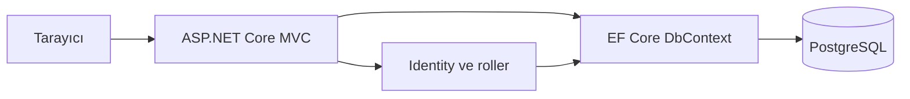

# CORE Portal Faz 1 Teknik Dokümanı

## Altyapı Veritabanı ve Kimlik Yönetimi

**Kapsam:** Plan belgesinin 1 ve 2. haftasında Mehmet Akalın'a verilen proje mimarisi, PostgreSQL bağlantısı, ASP.NET Core Identity ve rol yönetimi işleri. Bu doküman 3 Kasım 2026 tarihindeki `main` dalı durumunu açıklar.

## 1. Fazın çıktısı

CORE Portal için .NET 10 tabanlı bir ASP.NET Core MVC uygulaması oluşturuldu. Uygulama PostgreSQL'e Entity Framework Core ve Npgsql üzerinden bağlanır. İlk şema `InitialPostgres` migration dosyasında tutulur ve uygulama açılırken uygulanır. Identity kullanıcıları ile `Admin` ve `Member` rolleri aynı veritabanındadır.



### Teknoloji bileşenleri

| Bileşen | Kullanım | Kaynak |
| --- | --- | --- |
| .NET 10 ve ASP.NET Core MVC | Controller, Razor View ve HTTP hattı | `src/CorePortal.Web/CorePortal.Web.csproj`, `src/CorePortal.Web/Program.cs` |
| Entity Framework Core | ORM, ilişkiler ve migration | `src/CorePortal.Web/Data/ApplicationDbContext.cs` |
| Npgsql | PostgreSQL sağlayıcısı | `CorePortal.Web.csproj`, `Program.cs` |
| ASP.NET Core Identity | Kullanıcı, parola, oturum ve roller | `src/CorePortal.Web/Models/Domain.cs`, `src/CorePortal.Web/Controllers/AccountController.cs` |
| Bootstrap 5 | Temel duyarlı arayüz | `src/CorePortal.Web/Views/Shared/_Layout.cshtml` |

## 2. Uygulama başlatma sırası

`Program.cs` önce `DefaultConnection` bağlantı dizesiyle `ApplicationDbContext` kaydeder. Ardından Identity, MVC, Swagger ve GitHub HTTP istemcisi eklenir. `DbSeed.SeedAsync` uygulama dinlemeye başlamadan önce çalışır:

1. `Database.MigrateAsync()` bekleyen EF Core migration dosyalarını uygular.
2. `Admin` ve `Member` rollerini mevcut değillerse oluşturur.
3. `BootstrapAdmin:Email` ve `BootstrapAdmin:Password` sağlanmışsa ilk Admin hesabını oluşturur.
4. Aynı e-postaya sahip sıradan bir hesap varsa bu hesabı otomatik yükseltmek yerine başlangıcı hata ile durdurur.

Bu başlangıç biçimi nedeniyle PostgreSQL erişimi ve şema oluşturma yetkisi uygulama açılışında gereklidir. Üretim ortamında migration yetkisinin ve uygulanma zamanının ayrıca planlanması gerekir.

## 3. Veri modeli ve ilişkiler

`ApplicationDbContext`, Identity tablolarına ek olarak aşağıdaki alan kümelerini yönetir:

| Varlık | Ana alanlar | İlişki |
| --- | --- | --- |
| `ApplicationUser` | `FullName`, `Department`, Identity iletişim ve oturum alanları | Etkinlik, takım başvurusu ve duyuru yazarı |
| `Event` | Başlık, açıklama, UTC başlangıç, konum, kontenjan, afiş URL | Birden çok etkinlik başvurusu |
| `EventRegistration` | Kullanıcı, etkinlik, başvuru tarihi, durum | `Event` ve `ApplicationUser` |
| `Team` | Ad, çalışma alanı, kuruluş yılı, açıklama | Birden çok proje ve takım başvurusu |
| `Project` | Ad, özet, durum, görsel ve GitHub URL | Bir takıma bağlı |
| `TeamApplication` | Kullanıcı, takım, motivasyon, yetkinlikler, durum | `Team` ve `ApplicationUser` |
| `Announcement` | Başlık, içerik, yayın tarihi, yazar | `ApplicationUser` |

`EventRegistration` için `(EventId, UserId)`, `TeamApplication` için `(TeamId, UserId)` birleşik benzersiz indeksleri tanımlıdır. Başvuru durumları `Pending`, `Approved` ve `Rejected` değerlerinden oluşur. `Announcement` tablosu hazırdır; duyuru ekranları henüz bu fazın çıktısı değildir.

Şema kaynağı `src/CorePortal.Web/Data/Migrations/20261103092045_InitialPostgres.cs` dosyasıdır. Önceki MVC şablonunun SQLite migration dosyaları kaldırılarak PostgreSQL için tek bir başlangıç migration üretildi.

## 4. Kimlik ve yetkilendirme akışı

`AccountController` şu uç noktaları sağlar:

| İşlem | HTTP | Yol | Davranış |
| --- | --- | --- | --- |
| Kayıt formu | GET | `/account/register` | E-posta, ad soyad, bölüm ve parola alanlarını gösterir |
| Kullanıcı oluşturma | POST | `/account/register` | Identity hesabı oluşturur, `Member` rolü verir, oturum açar |
| Giriş | GET/POST | `/account/login` | Parola doğrulaması ve isteğe bağlı kalıcı oturum |
| Çıkış | POST | `/account/logout` | Oturumu kapatır |

Form POST işlemlerinde antiforgery doğrulaması vardır. Giriş sonrası dönüş adresi yalnızca yerel URL ise kullanılır. Yönetim alanı `[Authorize(Roles = "Admin")]` ile korunur. API için yetkisiz erişim HTML yönlendirmesi yerine `401`, rolü yetersiz erişim `403` döndürür.

Kimlik ayarında hesap onayı zorunlu değildir; e-posta doğrulama veya parola sıfırlama akışı henüz eklenmemiştir. İlk Admin kimlik bilgileri kaynak koduna gömülmez.

## 5. Yerel kurulum

Ön koşullar: .NET 10 SDK, çalışan PostgreSQL ve uygulamanın erişebileceği boş bir veritabanı. Gerçek parolalar `appsettings.json` içine kaydedilmemelidir; dosyadaki `change-me` yalnızca örnek değerdir.

```powershell
$env:ConnectionStrings__DefaultConnection = 'Host=localhost;Port=5432;Database=core_portal;Username=core_portal;Password=YOUR_PASSWORD'
$env:BootstrapAdmin__Email = 'admin@example.com'
$env:BootstrapAdmin__Password = 'CHOOSE_A_LONG_RANDOM_PASSWORD'
dotnet restore src/CorePortal.Web/CorePortal.Web.csproj
dotnet run --project src/CorePortal.Web/CorePortal.Web.csproj
```

Başlangıç hesabı yalnızca ilk kurulum için düşünülmüştür. Yerel doğrulamada geçici PostgreSQL üzerinde migration, rol oluşturma, Admin girişi ve üye kaydı başarıyla çalıştırıldı.

## 6. Fazın sınırı

Bu faz veri yapısını ve oturum altyapısını sağlar. Takım, proje, etkinlik ve yönetim ekranlarının davranışı Faz 2'de; API ve harici entegrasyon Faz 3'te açıklanır.
