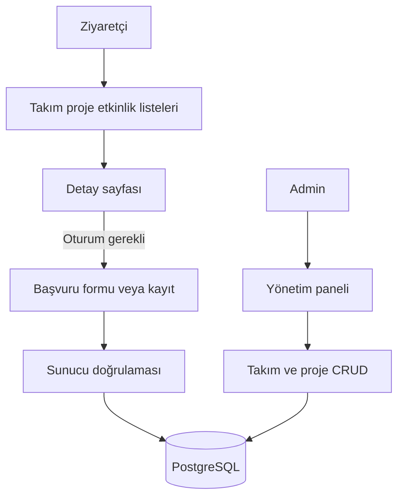

# CORE Portal Faz 2 Teknik Dokümanı

## MVC Modülleri Başvurular ve Yönetim Paneli

**Kapsam:** Plan belgesinin 3–6. haftasında Mehmet Akalın'a verilen takım ve proje görüntüleme, etkinlik başvurusu, Admin panel altyapısı, takım/proje CRUD ve takım başvurusu işleri. Bu doküman 3 Kasım 2026 tarihindeki kod durumunu açıklar.

## 1. Fazın çıktısı

Herkese açık takım, proje ve etkinlik sayfaları; oturum açmış kullanıcıya özel başvuru işlemleri; Admin rolüne özel takım ve proje yönetim ekranları eklendi. Sayfalar Razor View ile sunulur ve ortak gezinme şablonu Bootstrap kullanır.

## 2. Okuma sayfaları

| Modül | Yollar | Veri erişimi ve görünüm |
| --- | --- | --- |
| Takımlar | `/Teams`, `/Teams/Details/{id}` | Ad sırasıyla liste; detayda bağlı projeler. `TeamsController` ve `Views/Teams` |
| Projeler | `/Projects`, `/Projects/Details/{id}` | Takımıyla birlikte liste ve detay. `ProjectsController` ve `Views/Projects` |
| Etkinlikler | `/Events`, `/Events/Details/{id}` | Tarihe göre liste; detayda konum, açıklama ve doluluk. `EventsController` ve `Views/Events` |

Liste ve detay sorguları `AsNoTracking` kullanır. Bulunmayan detay kayıtlarında `404` döner. Proje listesi, yapılandırılmışsa GitHub'dan gelen depo listesini de ayrı bölümde gösterir; bu harici bölüm Faz 3'te ele alınır.

`Views/Shared/_Layout.cshtml` gezinme, oturum bağlantıları, yalnızca Admin'e gösterilen yönetim bağlantısı ve işlem mesajlarını içerir. `wwwroot/css/site.css` ile temel dar ekran düzeni ve yatay taşan tablolar için kaydırma eklendi. Gerçek cihazlarda kapsamlı görsel kontrol henüz yapılmadı.

## 3. Takım başvurusu

`GET /Teams/Apply/{id}` formu takımın varlığını doğrular. `POST /Teams/Apply/{id}` yalnızca giriş yapan kullanıcılar için açıktır ve antiforgery token ister. `TeamApplicationForm` alanları:

| Alan | Doğrulama |
| --- | --- |
| `Motivation` | Zorunlu, 20–2000 karakter |
| `Skills` | Zorunlu, en fazla 1000 karakter |

Controller, aynı kullanıcının aynı takıma daha önce başvurup başvurmadığını kontrol eder. Veritabanındaki `(TeamId, UserId)` benzersiz indeksi eşzamanlı tekrar gönderimlere karşı ikinci korumadır. Başvuru `Pending` durumuyla ve UTC başvuru tarihiyle kaydedilir. Başarılı işlem takım detayına yönlendirir ve kullanıcıya mesaj gösterir.

Mevcut kural, reddedilmiş bir başvurunun bile aynı kullanıcı ve takım için yeniden gönderilmesine izin vermez. Yönetici onay/red ekranları bu fazda uygulanmadı; bunlar plan belgesinde Mehmet Tarık Özcan'a atanmıştır.

## 4. Etkinlik başvurusu ve kontenjan

`POST /Events/Register/{id}` oturum ve antiforgery doğrulaması ister. İşlem PostgreSQL üzerinde `Serializable` yalıtım düzeyinde transaction başlatır ve şu koşulları denetler:

1. Etkinlik mevcut olmalı ve `StartsAt` değeri geçmemiş olmalı.
2. `Pending` veya `Approved` başvuruların sayısı `Capacity` değerinden küçük olmalı. `Rejected` başvurular doluluğa dahil edilmez.
3. Kullanıcı daha önce aynı etkinliğe başvurmamış olmalı.

Başarılı kayıt `Pending` durumunda oluşturulur. `(EventId, UserId)` benzersiz indeksi tekrar başvuruya karşı veritabanı düzeyinde koruma sağlar. Doluluk detay sayfasında `kayıt / kontenjan` olarak gösterilir. Eşzamanlı yoğun yükte transaction çakışmasının kullanıcıya daha ayrıntılı ele alınması ileride geliştirilebilir.

## 5. Admin paneli ve CRUD

`AdminController` sınıfının tamamı `[Authorize(Roles = "Admin")]` ile korunur. `/admin` paneli takım, proje ve bekleyen iki başvuru türünün sayılarını gösterir. Panelde başvuruları onaylama veya reddetme eylemi henüz bulunmaz.

| Kaynak | Liste | Oluşturma | Düzenleme | Silme |
| --- | --- | --- | --- | --- |
| Takım | `GET /admin/teams` | `GET/POST /admin/teams/create` | `GET/POST /admin/teams/{id}/edit` | `POST /admin/teams/{id}/delete` |
| Proje | `GET /admin/projects` | `GET/POST /admin/projects/create` | `GET/POST /admin/projects/{id}/edit` | `POST /admin/projects/{id}/delete` |

Yazma formları `TeamForm` ve `ProjectForm` doğrulama modellerini kullanır; varlık nesneleri doğrudan form girdisine bağlanmaz. Proje oluşturma ve düzenlemede seçilen takımın gerçekten var olduğu ayrıca denetlenir. POST işlemleri antiforgery doğrulaması gerektirir. Silme butonunda istemci tarafı onay iletişimi vardır ve sunucu yalnızca Admin rolüne izin verir.

Bu panel, Mehmet'e atanan takım/proje CRUD kapsamını karşılar. Etkinlik ve duyuru için Admin form ekranları Tarık'ın planlanan sorumluluğundadır; `Events` CRUD ayrıca Faz 3'te API olarak sağlanır.

## 6. Doğrulama ve faz sınırı

Geçici gerçek PostgreSQL veritabanında Admin girişinin ardından takım ve proje oluşturma, üye kaydı, takım başvurusu, etkinlik başvurusu ve kontenjan sayımı uçtan uca çalıştırıldı. Tekrarlanabilir akış `tests/Smoke.ps1` dosyasındadır. Faz 3, REST API, GitHub bağlantısı ve test kapsamını ayrıntılandırır.
